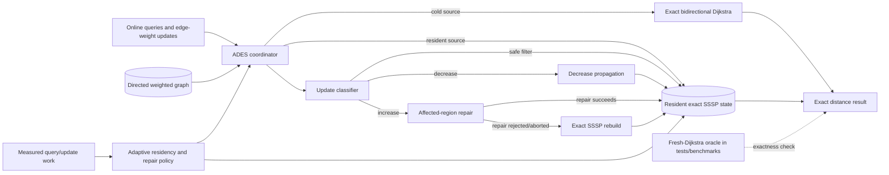

# ADES — Adaptive Dynamic Exact Shortest Paths

ADES is a C++20 research implementation for **exact online shortest-path queries** on directed graphs with nonnegative integer edge weights while edge weights change over time. It combines exact cold queries, selectively resident single-source shortest-path (SSSP) state, local dynamic repair, and adaptive source-residency policies.

> **Research status:** ADES is an experimental algorithms system. The repository preserves reproducible benchmark evidence, negative results, and frozen experimental lineage. It does **not** claim universal shortest-path superiority, established algorithmic novelty, or asymptotic improvement over the literature.

## Problem

For a directed graph `G = (V, E)` with nonnegative integer weights, ADES processes an online sequence of:

- `QUERY source target`
- `UPDATE edge_id old_weight new_weight`

Every returned distance must equal the distance produced by a fresh exact oracle on the same graph state. Adaptivity is used only to decide **which exact state to retain and how to maintain it**; it is not permitted to relax correctness.

## How ADES works

A query for a nonresident source is answered by exact bidirectional Dijkstra. Repeated or economically valuable sources can be promoted into resident exact SSSP state. Weight decreases use strict-improvement propagation. Weight increases first apply exact filters and, when necessary, repair the affected region; repair can fall back to a complete exact rebuild. The adaptive controller uses measured work/cost signals to decide admission, eviction, and repair-versus-rebuild policy.

The formal algorithm, invariants, repair rules, and proof sketch are documented in [`docs/ALGORITHM.md`](docs/ALGORITHM.md). Correctness obligations are summarized in [`docs/correctness-obligations.md`](docs/correctness-obligations.md).

## Architecture



See [`docs/architecture.md`](docs/architecture.md) for component boundaries and data flow.

## Baselines

The benchmark harness preserves the established baseline semantics:

| Baseline | Meaning |
| --- | --- |
| **B0** | Fresh exact Dijkstra for every query. |
| **B1** | Fresh exact bidirectional Dijkstra for every query. |
| **B2** | Always-resident exact SSSP; every weight change rebuilds every materialized source. |
| **B3** | Always-resident exact SSSP; local exact dynamic repair with rebuild fallback. |
| **B4** | Full ADES: cold bidirectional queries, adaptive admission, bounded resident state, local repair, and adaptive repair/rebuild policy. |

Bounded-residency comparator variants used by research experiments remain available where required by their frozen protocols. Baseline labels are scientific identifiers and are intentionally stable.

## Build

Requirements:

- C++20 compiler
- CMake 3.20+
- zlib development headers

```bash
cmake -S . -B build -DCMAKE_BUILD_TYPE=Release
cmake --build build -j
ctest --test-dir build --output-on-failure
```

## Run

Load a DIMACS `.gr.gz` graph:

```bash
./build/ades_cli benchmarks/data/USA-road-d.NY.gr.gz
```

Query a source/target pair:

```bash
./build/ades_cli benchmarks/data/USA-road-d.NY.gr.gz 1 1000
```

The benchmark and experiment executables are built by the same CMake project. Start with [`docs/benchmark-methodology.md`](docs/benchmark-methodology.md) and [`docs/reproducibility.md`](docs/reproducibility.md) before interpreting timing results.

## Reproducible benchmark data

The canonical road-network corpus is the 9th DIMACS Shortest Paths New York data. Place or fetch the expected files under `benchmarks/data/` and verify their exact hashes:

```bash
bash tools/fetch_ny_dimacs.sh benchmarks/data
bash tools/verify_ny_dimacs.sh benchmarks/data
```

The repository also contains a dataset registry, synthetic workload tooling, canonical trace identity, comparator qualification rules, memory-accounting gates, ablation tooling, and crossover experiments. Performance evidence is admissible only when exactness and provenance checks pass.

## Evidence model

ADES separates three things that are easy to conflate:

1. **Correctness evidence** — exact agreement with independent/fresh shortest-path oracles on tested traces.
2. **Performance evidence** — measured runtime/memory behavior for a precisely defined graph, workload, comparator, machine, and configuration.
3. **Research claims** — conclusions whose scope must not exceed the supporting evidence.

The current evidence ledger is [`docs/evidence-ledger.md`](docs/evidence-ledger.md). Known rejected mechanisms and counterexamples are retained in [`docs/refutations.md`](docs/refutations.md). Historical run identifiers, frozen manifests, checksums, and campaign terminology are preserved only where they are required to reproduce or audit old experiments; see [`research/README.md`](research/README.md).

## Repository layout

```text
include/ades/           Public/internal C++ headers
src/                    ADES implementation and CLI
benchmarks/             Benchmark executables, datasets, registries, harnesses
examples/               Example inputs/usages when present
tests/                  Correctness, regression, memory, telemetry and workload tests
tools/                  Current operational and benchmarking entry points
docs/                   Evergreen algorithm, architecture and methodology docs
research/               Historical research protocols and frozen implementation lineage
evidence/               Immutable/reproducible evidence packages and provenance
results/                Checked-in historical result packages plus generated output space
.github/workflows/      CI and research verification gates
```

## Testing and verification

The default CI compiles benchmark Python tooling, builds the complete CMake project, and runs the registered CTest suite. Additional workflows exercise dataset integrity, workload determinism, memory-budget fairness, telemetry reconciliation, scientific ablations, comparator qualification, crossover experiments, and the frozen economic-controller evaluations.

Do not weaken an exactness, trace-identity, provenance, checksum, memory-accounting, or comparator-eligibility gate to obtain a favorable performance result.

## Limitations

- The implementation targets directed graphs with nonnegative integer weights.
- Empirical results are workload- and machine-dependent.
- Adaptive policy quality is not an exactness guarantee and can be unfavorable on some workloads.
- Logical persistent-state budgets and process RSS are distinct measurements.
- Historical experiments span multiple controller versions and must be interpreted under their frozen protocols.
- A favorable benchmark slice is not evidence of universal or theoretical superiority.

## Publication status

This repository is maintained as a research artifact and implementation. Publication-oriented protocols and archived experiments are retained for reproducibility, but the default branch does not present benchmark performance as proof of novelty. Any manuscript or publication claim must cite the exact frozen candidate, comparator contract, dataset/workload identity, evidence package, and limitations that support it.

## Research history

Development-era chronology has been removed from the product-facing tree. Scientifically meaningful historical documents and frozen runners remain under [`research/`](research/) or in immutable evidence/result packages. Historical identifiers are retained there when changing them would damage provenance or reproducibility.

## License

See [`LICENSE`](LICENSE) for the repository's licensing terms.
