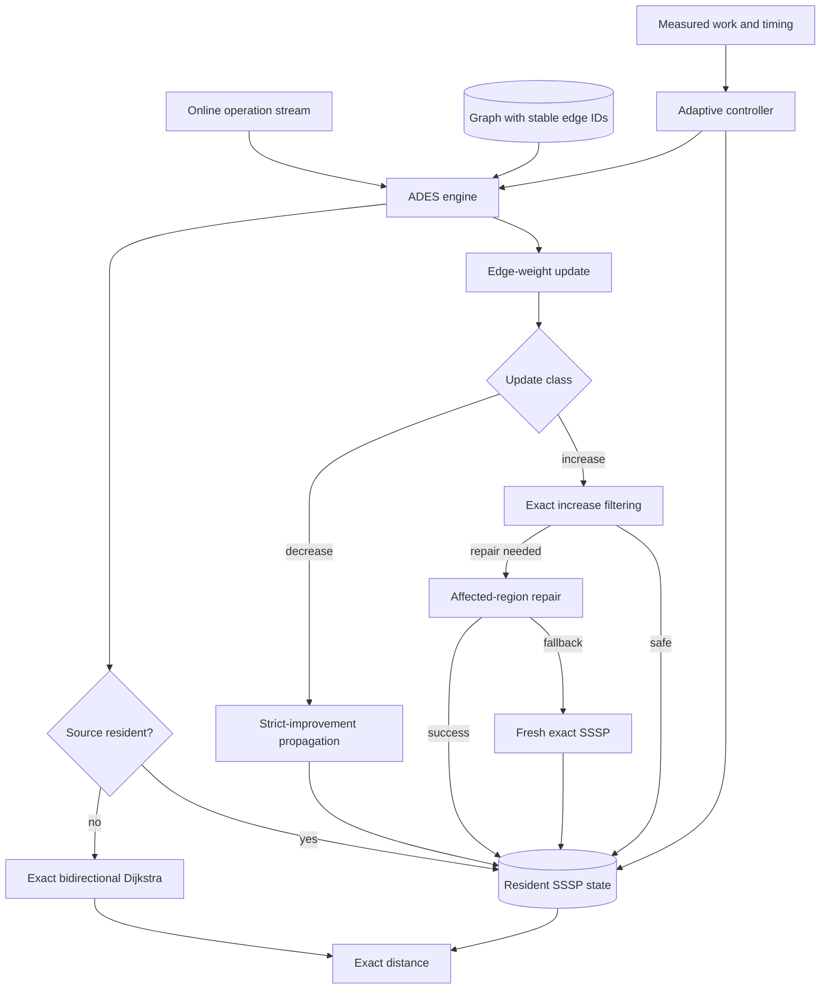

# Architecture

ADES separates exact shortest-path semantics from adaptive performance policy. The graph and repair primitives determine correctness; admission, eviction and repair-budget controllers only decide which exact strategy is used for a source or update.

## System view

## Components

### Graph layer

`Graph` owns directed edges, stable edge identifiers, forward adjacency and reverse adjacency. Dynamic updates modify weights while preserving edge identity. Shortest-path code assumes nonnegative integer weights and uses overflow-safe distance handling.

### Exact cold-query layer

A source without resident SSSP state is answered with exact bidirectional Dijkstra. Fresh Dijkstra remains available as an oracle and rebuild mechanism.

### Resident SSSP layer

Promoted sources retain exact distances plus parent/child structure needed by dynamic repair. A resident state is always expected to represent an exact SSSP solution for the current graph state.

### Dynamic update layer

Weight decreases propagate strict improvements. Weight increases use exact filtering and affected-region discovery. Local repair may be rejected or aborted under its safety/budget rules, in which case the source is rebuilt exactly.

### Adaptive policy layer

Admission, eviction, residency and repair-budget decisions use workload measurements and controller state. These decisions may affect runtime and memory consumption, but they cannot authorize approximate distances.

### Benchmark and verification layer

The benchmark harness generates or replays deterministic operation traces, validates trace identity, compares results with an exact oracle, records timing/memory telemetry, and only then admits performance measurements. Separate workflow gates cover dataset identity, workload generation, memory accounting, comparator qualification and research experiments.

## Correctness boundary

The central architectural invariant is:

> Policy may choose among exact execution paths, but it may not change the required shortest-path answer.

For formal invariants and proof obligations, see [`ALGORITHM.md`](ALGORITHM.md) and [`correctness-obligations.md`](correctness-obligations.md).
